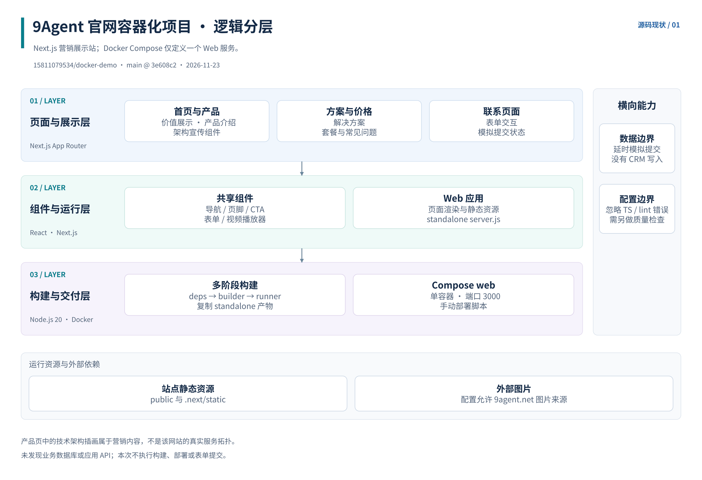

# 9Agent 官网容器化项目 · 架构说明

**状态：源码现状。** Next.js 营销展示站；Docker Compose 仅定义一个 Web 服务。

核对日期：2026-11-23。代码/文档基线：[`main@3e608c2`](https://github.com/15811079534/docker-demo/tree/3e608c2cbfa9979061a87d9ee8760aa0bf1db75c)。本页描述该提交可核对的范围，不代表线上运行或业务验收。

## 逻辑分层

[可编辑 draw.io 图源](diagrams/docker-demo-architecture.drawio) · [完整 PNG](diagrams/docker-demo-logical.png)

## 运行方式与关键边界

站点由 Next.js App Router 页面和 React 共享组件构成，页面包含首页、产品、解决方案、价格和联系入口。联系表单通过延时 Promise 模拟提交结果，未接入真实业务接口或 CRM。产品页的 `TechArchitecture` 是介绍产品能力的展示组件，不能拿来当此仓库的后端服务架构。

`next.config.ts` 输出 standalone。Dockerfile 按依赖、构建、运行三个阶段打包，运行阶段启动 `node server.js`；Compose 只定义 `web`，将 3000 端口映射到宿主机。仓库部署文档描述手动脚本流程，根目录没有 GitHub Actions 自动部署工作流；提交文档不会由这些脚本自动执行部署。

当前配置允许构建忽略 TypeScript 和 ESLint 错误，因此不能从构建产物存在推断静态质量检查通过。本次只验证架构文档、图源和链接，没有启动站点或连接生产服务器。

## 源码与文档依据

| 依据 | 本次核对内容 |
|---|---|
| [src/app/page.tsx](../src/app/page.tsx) | 首页组件组合 |
| [src/app/contact/page.tsx](../src/app/contact/page.tsx) | 联系页入口 |
| [src/components/shared/ContactForm.tsx](../src/components/shared/ContactForm.tsx) | 模拟表单提交 |
| [src/app/product/components/TechArchitecture.tsx](../src/app/product/components/TechArchitecture.tsx) | 营销用途架构展示 |
| [next.config.ts](../next.config.ts) | standalone、远程图片与构建检查配置 |
| [Dockerfile](../Dockerfile) | 多阶段构建与运行命令 |
| [docker-compose.yml](../docker-compose.yml) | 单服务运行边界 |
| [AUTO_DEPLOY_GUIDE.md](../AUTO_DEPLOY_GUIDE.md) | 手动部署脚本说明 |

## 维护方式

以当前源码、路由和配置为准更新正文与 `.drawio`，同步导出同名 PNG，并保留基线提交和实现状态。逻辑层表示职责；只有实际独立运行单元才按服务边界理解。新增数据库、鉴权、外部接口或部署链路时，先核对调用代码，再更新图。

本次已检查 XML 结构、离线路由、中文排版、连线与预览；PNG 由本地渲染链生成，尚未在原生 draw.io 编辑器中完整导出复验。图形检查不替代应用测试或生产验收。
